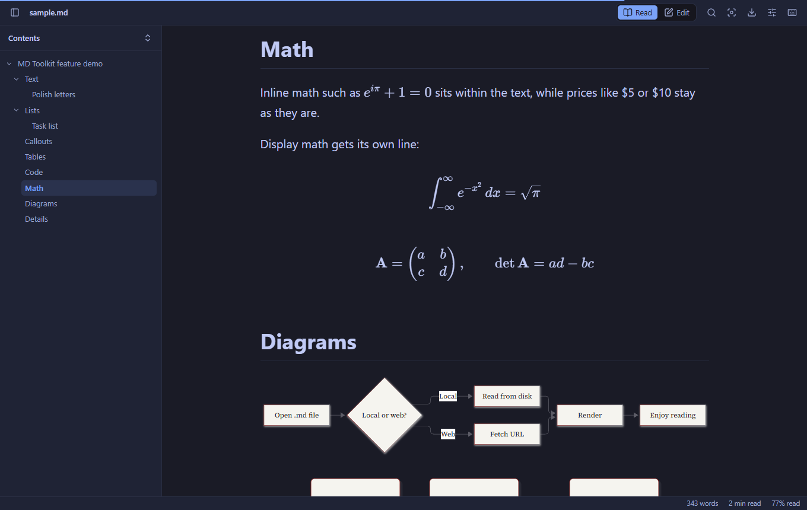
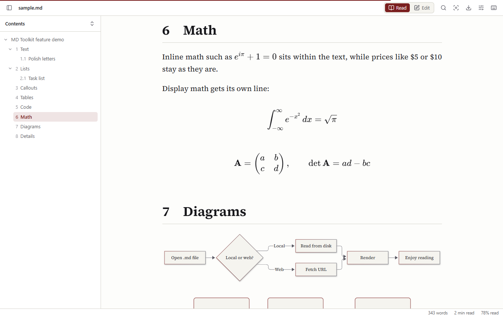
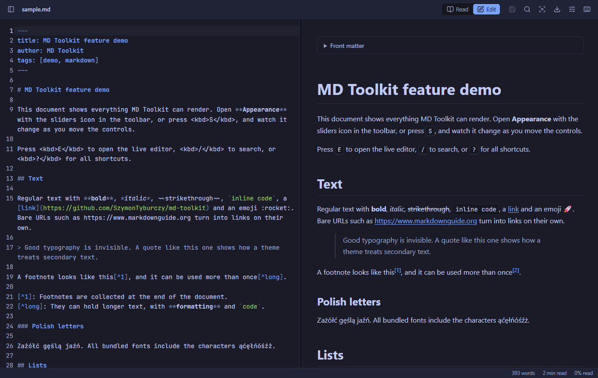
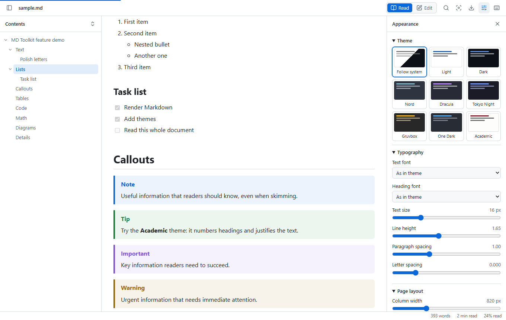
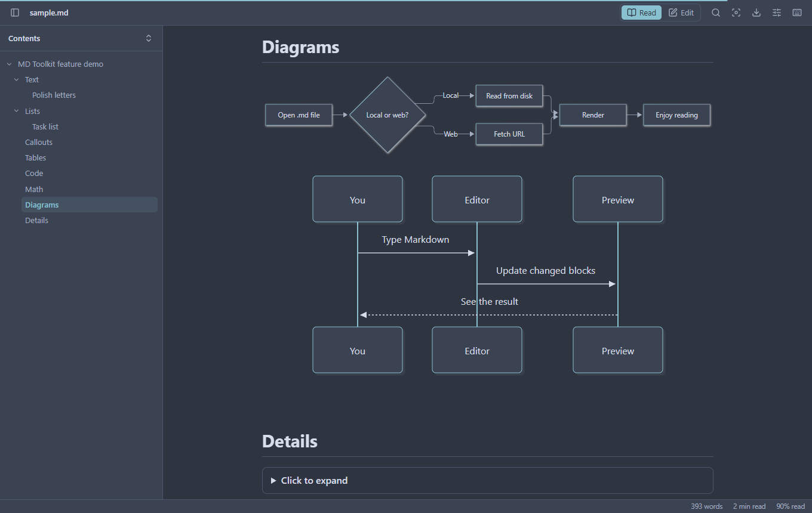

# MD Toolkit

**English** | [Polski](README.pl.md)

A Markdown viewer and editor for Google Chrome, built around one idea: you decide how your documents look.

[](https://github.com/SzymonTyburczy/md-toolkit/actions/workflows/ci.yml)
[](LICENSE)



## Features

**Open documents from anywhere**
- Local `.md` files render as soon as you open them
- Raw files on GitHub, Gist and GitLab render automatically
- Any other website, after you allow it on the options page
- Paste text into a new document, with an automatic draft

**Control the look**
- 8 themes plus system mode: Light, Dark, Nord, Dracula, Tokyo Night, Gruvbox, One Dark and Academic
- Typography: text and heading fonts, size, line height, paragraph and letter spacing
- Layout: column width, margins, justification, hyphenation, accent colour
- Headings and code: numbering, size ratio, code font and size, line wrapping, line numbers, table styles
- Everything applies live from a side panel, and fonts are bundled, so nothing is fetched from the network

**Full Markdown rendering**
- Syntax highlighting with a copy button
- GitHub Flavored Markdown: tables, task lists, strikethrough, autolinks
- Footnotes, `> [!NOTE]` callouts, emoji shortcodes, YAML front matter
- Math with KaTeX (`$...$`, `$$...$$`, ` ```math `)
- Mermaid diagrams, drawn in the colours of your theme

**Tools**
- Table of contents with section tracking and collapsible levels
- Split editor with live preview, synced scrolling and saving to disk
- Auto-reload that keeps your scroll position and never overwrites unsaved edits
- Search with match count, reading progress, word count and reading time
- Focus mode that dims everything but the current block
- Export to a self-contained HTML file, print to PDF, copy as formatted text or HTML

The interface is available in English and Polish.

| Academic theme | Live editor |
| --- | --- |
|  |  |

| Appearance panel | Diagrams follow the theme |
| --- | --- |
|  |  |

## Installation

MD Toolkit is not on the Chrome Web Store yet, so it is installed as an unpacked extension.

1. Download `md-toolkit-x.y.z.zip` from [Releases](https://github.com/SzymonTyburczy/md-toolkit/releases) and unzip it, or [build it yourself](#development).
2. Open `chrome://extensions` and turn on **Developer mode**.
3. Click **Load unpacked** and select the unzipped folder (or `dist`).
4. **To open local files:** click **Details** on MD Toolkit and turn on **Allow access to file URLs**.

## Usage

| Key | Action |
| --- | --- |
| <kbd>T</kbd> | Show or hide the table of contents |
| <kbd>E</kbd> | Switch between reading and editing |
| <kbd>/</kbd> | Search in the document |
| <kbd>F</kbd> | Focus mode |
| <kbd>S</kbd> | Show or hide appearance settings |
| <kbd>Ctrl</kbd>+<kbd>S</kbd> | Save, while editing |
| <kbd>Ctrl</kbd>+<kbd>B</kbd> / <kbd>I</kbd> / <kbd>K</kbd> | Bold, italic, link, in the editor |
| <kbd>?</kbd> | Show all shortcuts |

Add `#mdt-raw` to a URL to see the original file instead of the viewer.

### Saving files

Chrome does not let an extension write to a file it merely opened. The first save in a session therefore asks you where to save, so pick the original file to overwrite it. Later saves go straight to that file.

### Troubleshooting

- **A local file shows as plain text:** turn on **Allow access to file URLs**, then reload the tab.
- **A `.md` link downloads instead of opening:** the server sends it as `application/octet-stream`, so Chrome downloads it before any extension can act. The same can happen with local files on Linux when the system does not know the `text/markdown` type.
- **A web file is not rendered:** only GitHub, Gist and GitLab work out of the box. Turn on **All other websites** on the options page, or use **Open this tab in MD Toolkit** in the toolbar popup.

## Development

Requires Node.js 22 or newer.

```bash
git clone https://github.com/SzymonTyburczy/md-toolkit.git
```

```bash
cd md-toolkit
```

```bash
npm install
```

```bash
npm run build
```

Then load `dist` as described above.

| Command | Purpose |
| --- | --- |
| `npm run dev` | Rebuild on every change, then reload the extension in Chrome |
| `npm test` | Unit tests |
| `npm run typecheck` | TypeScript checks |
| `npm run test:e2e` | End-to-end tests in a real Chromium, after a build |
| `npm run package` | Build and create a release zip in `release/` |

The end-to-end tests need Chrome for Testing, because regular Chrome no longer loads extensions from the command line:

```bash
npx puppeteer browsers install chrome
```

### How it works

A small content script runs on URLs that look like Markdown. If the page is plain text, it hands the URL to the viewer, an extension page that fetches and renders the document. Rendering there, rather than inside the original page, means strict headers such as the `sandbox` policy on `raw.githubusercontent.com` cannot break diagrams, math or fonts.

```
src/
  content/     Detects Markdown pages and redirects to the viewer
  background/  Keeps the all-sites redirect in step with permissions
  markdown/    Rendering pipeline: markdown-it plugins and sanitizing
  viewer/      The viewer: preview, editor, panels, export
  options/     Options and welcome page
  popup/       Toolbar popup
  shared/      Settings, themes, translations, helpers
public/styles/ Themes and document styles, also embedded in exports
```

Adding a theme takes one block of variables in `public/styles/themes.css` and one line in `src/shared/themes.ts`.

### Security

Documents are untrusted. All rendered HTML passes through [DOMPurify](https://github.com/cure53/DOMPurify), the extension's Content Security Policy forbids inline scripts, and a document from the web can never reference local files. The viewer refuses to run in a frame and only opens Markdown from disk.

## Privacy

No servers, analytics or accounts. See [PRIVACY.md](PRIVACY.md).

## License

[MIT](LICENSE). Bundled fonts and libraries keep their own licences, listed in [THIRD_PARTY_NOTICES.md](THIRD_PARTY_NOTICES.md).
