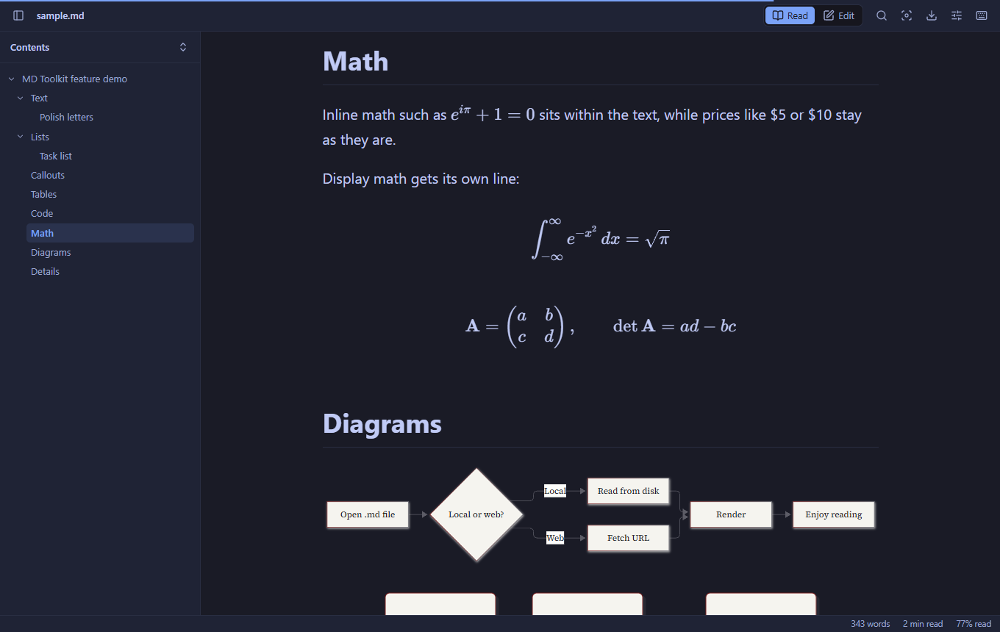
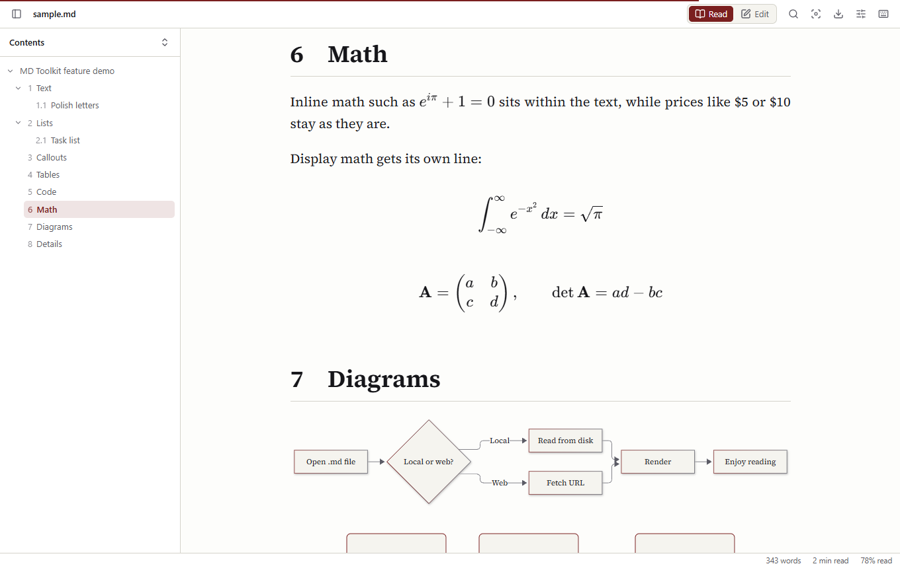
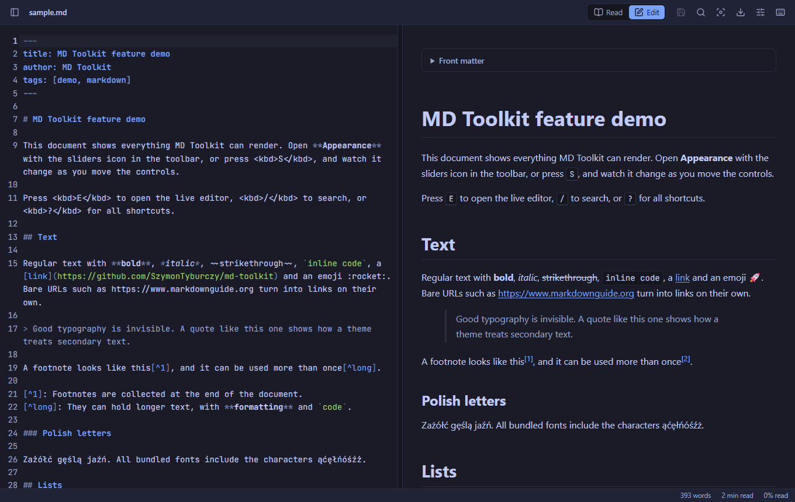
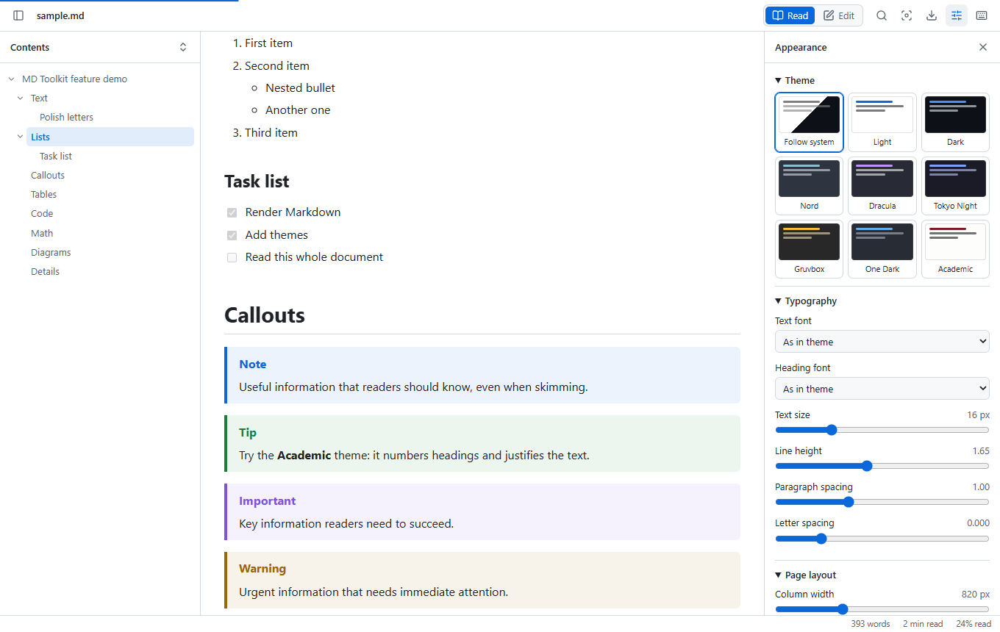
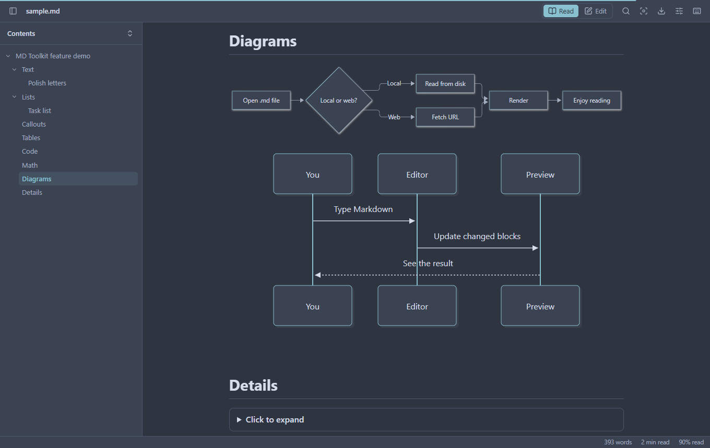
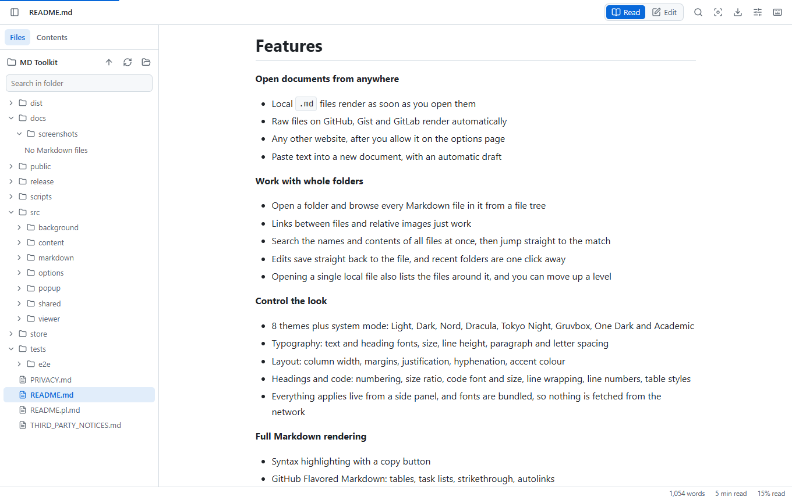

# MD Toolkit

[English](README.md) | **Polski**

Przeglądarka i edytor Markdown dla Google Chrome zbudowane wokół jednej idei: to Ty decydujesz, jak wyglądają Twoje dokumenty.

[](https://github.com/SzymonTyburczy/md-toolkit/actions/workflows/ci.yml)
[](LICENSE)



## Funkcje

**Otwieraj dokumenty skądkolwiek**
- Lokalne pliki `.md` renderują się od razu po otwarciu
- Surowe pliki z GitHuba, Gista i GitLaba renderują się automatycznie
- Dowolne inne strony po włączeniu w opcjach
- Wklejanie tekstu do nowego dokumentu z automatycznym szkicem

**Pracuj na całych folderach**
- Otwórz folder i przeglądaj wszystkie jego pliki Markdown w drzewie plików
- Linki między plikami i względne obrazki po prostu działają
- Przeszukuj nazwy i treść wszystkich plików naraz, a potem przejdź prosto do trafienia
- Zmiany zapisują się prosto do pliku, a ostatnie foldery są o jedno kliknięcie
- Po otwarciu pojedynczego pliku lokalnego widać też pliki wokół niego i można przejść poziom wyżej

**Decyduj o wyglądzie**
- 8 motywów i tryb systemowy: Jasny, Ciemny, Nord, Dracula, Tokyo Night, Gruvbox, One Dark i Akademicki
- Typografia: kroje tekstu i nagłówków, rozmiar, interlinia, odstępy między akapitami i literami
- Układ: szerokość kolumny, marginesy, justowanie, dzielenie wyrazów, kolor akcentu
- Nagłówki i kod: numeracja, skala, krój i rozmiar kodu, zawijanie linii, numery linii, style tabel
- Wszystko działa na żywo z panelu bocznego, a czcionki są dołączone do wtyczki, więc nic nie jest pobierane z sieci

**Pełne renderowanie Markdown**
- Kolorowanie składni z przyciskiem kopiowania
- GitHub Flavored Markdown: tabele, listy zadań, przekreślenia, automatyczne linki
- Przypisy, callouty `> [!NOTE]`, emoji, metadane YAML (front matter)
- Wzory w KaTeX (`$...$`, `$$...$$`, ` ```math `)
- Diagramy Mermaid rysowane w kolorach Twojego motywu

**Narzędzia**
- Spis treści śledzący aktualną sekcję, ze zwijaniem poziomów
- Edytor z podglądem na żywo, synchronizacją przewijania i zapisem na dysk
- Automatyczne odświeżanie, które zachowuje pozycję i nigdy nie nadpisuje niezapisanych zmian
- Wyszukiwarka z licznikiem trafień, postęp czytania, liczba słów i czas czytania
- Tryb skupienia przyciemniający wszystko poza bieżącym blokiem
- Eksport do samodzielnego pliku HTML, druk do PDF, kopiowanie jako tekst sformatowany lub HTML

Interfejs jest dostępny po polsku i angielsku.

| Motyw Akademicki | Edytor na żywo |
| --- | --- |
|  |  |

| Panel wyglądu | Diagramy podążają za motywem |
| --- | --- |
|  |  |



## Instalacja

MD Toolkit nie jest jeszcze w Chrome Web Store, więc instaluje się go jako rozszerzenie rozpakowane.

1. Pobierz `md-toolkit-x.y.z.zip` z [Releases](https://github.com/SzymonTyburczy/md-toolkit/releases) i rozpakuj albo [zbuduj samodzielnie](#rozwój).
2. Otwórz `chrome://extensions` i włącz **Tryb dewelopera**.
3. Kliknij **Załaduj rozpakowane** i wskaż rozpakowany folder (lub `dist`).
4. **Aby otwierać pliki lokalne:** kliknij **Szczegóły** przy MD Toolkit i włącz **Zezwalaj na dostęp do adresów URL plików**.

## Użycie

| Klawisz | Działanie |
| --- | --- |
| <kbd>T</kbd> | Pokaż lub ukryj panel boczny z plikami i spisem treści |
| <kbd>E</kbd> | Przełącz czytanie i edycję |
| <kbd>/</kbd> | Szukaj w dokumencie |
| <kbd>F</kbd> | Tryb skupienia |
| <kbd>S</kbd> | Pokaż lub ukryj ustawienia wyglądu |
| <kbd>Ctrl</kbd>+<kbd>S</kbd> | Zapisz podczas edycji |
| <kbd>Ctrl</kbd>+<kbd>B</kbd> / <kbd>I</kbd> / <kbd>K</kbd> | Pogrubienie, kursywa, link w edytorze |
| <kbd>?</kbd> | Pokaż wszystkie skróty |

Dopisz `#mdt-raw` do adresu, aby zobaczyć oryginalny plik zamiast podglądu.

### Foldery

Kliknij ikonę wtyczki, wybierz **Otwórz folder** i wskaż folder. Zakładka **Pliki** po lewej pokazuje jego pliki Markdown i podfoldery, a pole wyszukiwania przeszukuje nazwy i treść. Ukryte foldery, takie jak `.git`, oraz `node_modules` są pomijane. Wyszukiwanie obejmuje do 2000 plików.

Chrome pyta o zgodę, zanim wtyczka odczyta folder, i jeszcze raz przy pierwszym zapisie, zanim zmieni pliki. Po ponownym uruchomieniu przeglądarki pyta znowu, chyba że zezwolisz na dostęp przy każdej wizycie.

Po otwarciu pojedynczego pliku lokalnego zakładka **Pliki** pokazuje folder, w którym leży. Przycisk ze strzałką przechodzi poziom wyżej.

### Zapisywanie plików

W otwartym folderze zmiany zapisują się prosto do pliku. Do pliku otwartego osobno Chrome nie pozwala rozszerzeniu pisać, dlatego przy pierwszym zapisie w sesji wtyczka pyta, gdzie zapisać. Wskaż oryginalny plik, aby go nadpisać. Kolejne zapisy trafiają już prosto do niego.

### Rozwiązywanie problemów

- **Plik lokalny wyświetla się jako zwykły tekst:** włącz **Zezwalaj na dostęp do adresów URL plików** i odśwież kartę.
- **Link do `.md` pobiera plik zamiast go otworzyć:** serwer wysyła go jako `application/octet-stream`, więc Chrome pobiera plik, zanim rozszerzenie zdąży zareagować. To samo może się zdarzyć z plikami lokalnymi na Linuksie, gdy system nie zna typu `text/markdown`.
- **Plik z internetu się nie renderuje:** od razu działają tylko GitHub, Gist i GitLab. Włącz **Wszystkie inne strony** w opcjach albo użyj **Otwórz tę kartę w MD Toolkit** w menu ikony wtyczki.

## Rozwój

Wymaga Node.js 22 lub nowszego.

```bash
git clone https://github.com/SzymonTyburczy/md-toolkit.git
```

```bash
cd md-toolkit
```

```bash
npm install
```

```bash
npm run build
```

Następnie załaduj folder `dist` zgodnie z opisem powyżej.

| Polecenie | Do czego służy |
| --- | --- |
| `npm run dev` | Przebudowuje po każdej zmianie, potem przeładuj rozszerzenie w Chrome |
| `npm test` | Testy jednostkowe |
| `npm run typecheck` | Sprawdzanie typów TypeScript |
| `npm run test:e2e` | Testy end-to-end w prawdziwym Chromium, po buildzie |
| `npm run package` | Build i spakowanie wydania do `release/` |

Testy end-to-end korzystają z Chrome for Testing:

```bash
npx puppeteer browsers install chrome
```

Na Windowsie Smart App Control może zablokować tę pobraną przeglądarkę. Testy przełączają się wtedy na zainstalowany Chrome lub Edge, a zmienna środowiskowa `MDT_BROWSER` pozwala wskazać dowolną przeglądarkę opartą na Chromium.

Architekturę i strukturę katalogów opisuje [angielskie README](README.md#how-it-works).

## Prywatność

Żadnych serwerów, analityki ani kont. Szczegóły w [PRIVACY.md](PRIVACY.md).

## Licencja

[MIT](LICENSE). Dołączone czcionki i biblioteki mają własne licencje, wymienione w [THIRD_PARTY_NOTICES.md](THIRD_PARTY_NOTICES.md).
