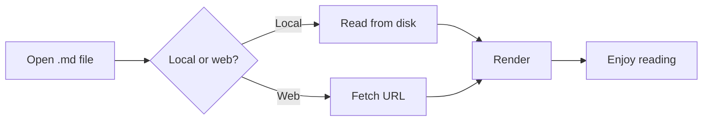
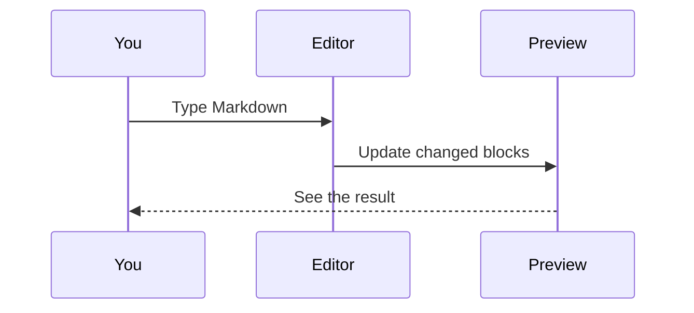

# MD Toolkit feature demo

This document shows everything MD Toolkit can render. Open **Appearance** with the sliders icon in the toolbar, or press <kbd>S</kbd>, and watch it change as you move the controls.

Press <kbd>E</kbd> to open the live editor, <kbd>/</kbd> to search, or <kbd>?</kbd> for all shortcuts.

## Text

Regular text with **bold**, *italic*, ~~strikethrough~~, `inline code`, a [link](https://github.com/SzymonTyburczy/md-toolkit) and an emoji :rocket:. Bare URLs such as https://www.markdownguide.org turn into links on their own.

> Good typography is invisible. A quote like this one shows how a theme treats secondary text.

A footnote looks like this[^1], and it can be used more than once[^long].

[^1]: Footnotes are collected at the end of the document.
[^long]: They can hold longer text, with **formatting** and `code`.

### Polish letters

Zażółć gęślą jaźń. All bundled fonts include the characters ąćęłńóśźż.

## Lists

1. First item
2. Second item
   - Nested bullet
   - Another one
3. Third item

### Task list

- [x] Render Markdown
- [x] Add themes
- [ ] Read this whole document

## Callouts

> [!NOTE]
> Useful information that readers should know, even when skimming.

> [!TIP]
> Try the **Academic** theme: it numbers headings and justifies the text.

> [!IMPORTANT]
> Key information readers need to succeed.

> [!WARNING]
> Urgent information that needs immediate attention.

> [!CAUTION]
> Advice about the risks of certain actions.

## Tables

| Theme       | Style    | Best for        |
| ----------- | :------: | --------------: |
| Light       | Clean    | Daytime reading |
| Tokyo Night | Dark     | Late-night code |
| Academic    | Serif    | Papers, reports |

## Code

```typescript
interface Reader {
  name: string;
  theme: 'light' | 'dark';
}

/* A block comment
   spanning two lines */
function greet(reader: Reader): string {
  return `Hello, ${reader.name}!`;
}
```

```python
from dataclasses import dataclass

@dataclass
class Point:
    x: float
    y: float

    def norm(self) -> float:
        return (self.x ** 2 + self.y ** 2) ** 0.5
```

```bash
git clone https://github.com/SzymonTyburczy/md-toolkit.git
cd md-toolkit && npm install && npm run build
```

## Math

Inline math such as $e^{i\pi} + 1 = 0$ sits within the text, while prices like $5 or $10 stay as they are.

Display math gets its own line:

$$
\int_{-\infty}^{\infty} e^{-x^2}\,dx = \sqrt{\pi}
$$

$$
\mathbf{A} = \begin{pmatrix} a & b \\ c & d \end{pmatrix}, \qquad \det \mathbf{A} = ad - bc
$$

## Diagrams





## Details

<details>
<summary>Click to expand</summary>

Hidden content can hold any Markdown, including `code` and **formatting**.

</details>

---

That is everything. Enjoy reading!
